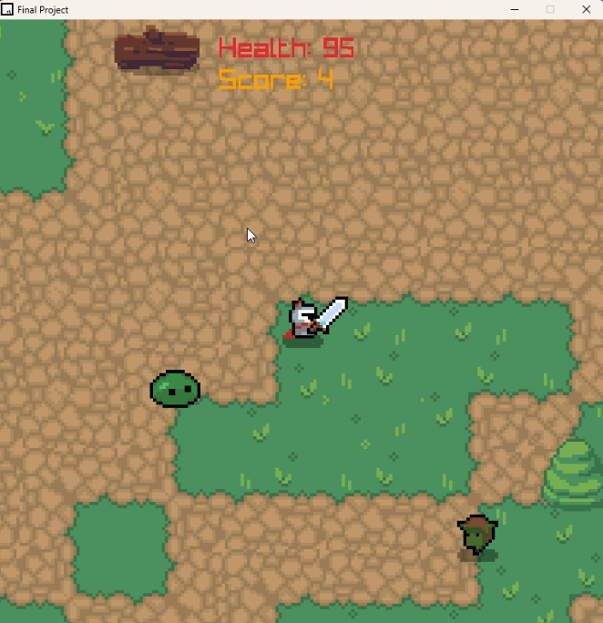

# 🎮 2D Adventure Game

A top-down 2D adventure game developed using **C++ and Raylib 6**. Control a knight, explore the world, fight enemies, and survive in a pixel-art environment.

## 📸 Gameplay Preview



## ✨ Features

- **Player Movement:** Smooth movement using WASD keys.
- **Character Animation:** Idle and running animations using sprite sheets.
- **Combat System:** Attack enemies using a sword.
- **Enemy AI:** Goblins and slimes follow the player.
- **Enemy Spawning:** New enemies spawn at random positions every 2 seconds.
- **Health System:** Player health decreases when enemies make contact.
- **Scoring System:** Earn points by defeating enemies.
- **Collision Detection:** Collision handling between the player, enemies, environment objects, and map boundaries.
- **Pause System:** Pause and resume gameplay.
- **Game Over & Restart:** Restart the adventure after losing all health.
- **Audio:** Background music and sword sound effects.

## 🎮 Controls

| Key | Action |
|:---:|---|
| W | Move Up |
| A | Move Left |
| S | Move Down |
| D | Move Right |
| Left Mouse Button | Attack |
| P | Pause / Resume |
| SPACE | Start / Restart Game |

## 🛠️ Built With

- **C++** – Core game logic and object-oriented programming.
- **Raylib 6** – Graphics, audio, input handling, and game rendering.
- **MinGW / GCC** – C++ compilation.
- **Visual Studio Code** – Development environment.

## 🧱 Object-Oriented Design

The project uses an object-oriented structure with inheritance and polymorphism.

- **BaseCharacter:** Parent class responsible for shared character properties, movement, animation, and collision handling.
- **Character:** Handles player movement, health, sword attacks, and player-specific functionality.
- **Enemy:** Implements enemy movement, player tracking, and contact damage.
- **Prop:** Handles environmental objects and their collision areas.

## 📁 Project Structure

```text
2D-Adventure-Game/
│
├── audio/                  # Sound effects and background music
├── characters/             # Character and enemy sprites
├── nt/                     # Map and environment assets
├── screenshots/            # Gameplay screenshots
│
├── BaseCharacter.cpp
├── BaseCharacter.h
├── Character.cpp
├── Character.h
├── Enemy.cpp
├── Enemy.h
├── prop.cpp
├── prop.h
│
├── final.cpp               # Main game file
├── Makefile
├── .gitignore
└── README.md
```

## ⚙️ Build and Run

### Prerequisites

- C++ compiler (MinGW / GCC)
- Raylib 6
- GNU Make

### Installation

Clone the repository:

```bash
git clone https://github.com/MuntakimKhondokerRahat/2D-Adventure-Game.git
```

Navigate to the project directory:

```bash
cd 2D-Adventure-Game
```

Build the project:

```bash
make
```

Run the generated executable.

**Note:** Make sure Raylib and its required libraries are properly installed and configured.

## 👨‍💻 Developer

**Muntakim Khondoker Rahat**

- GitHub: [MuntakimKhondokerRahat](https://github.com/MuntakimKhondokerRahat)

---

*Developed as a C++ game development project using Raylib 6.*
